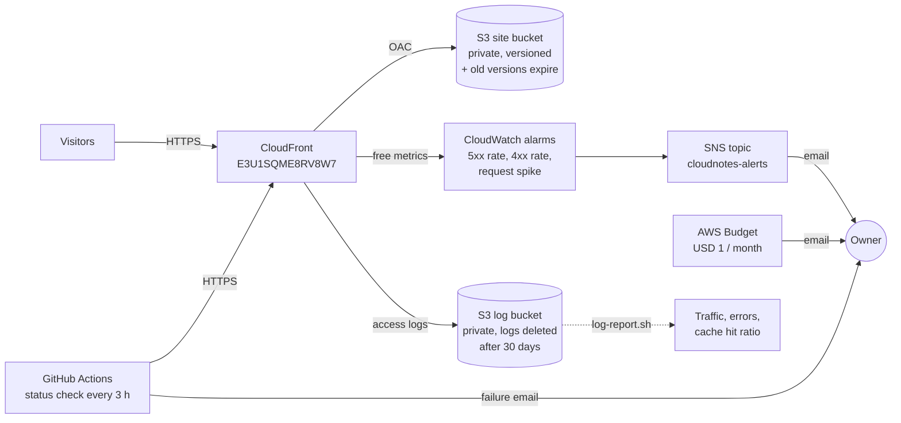
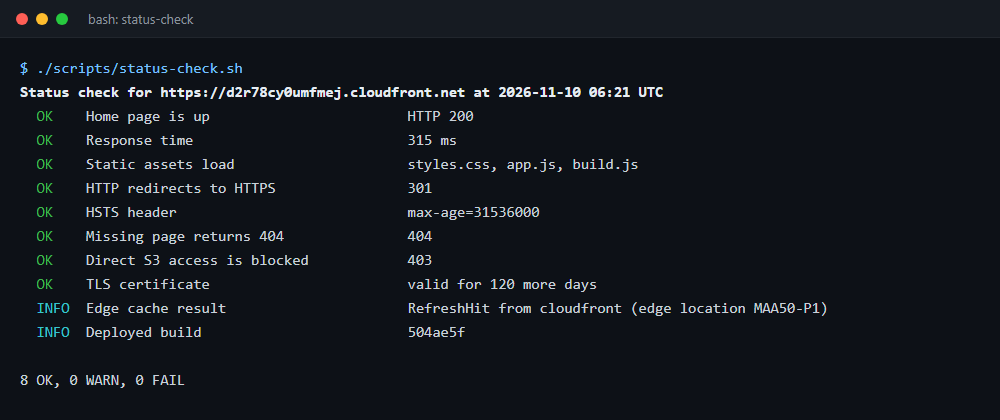
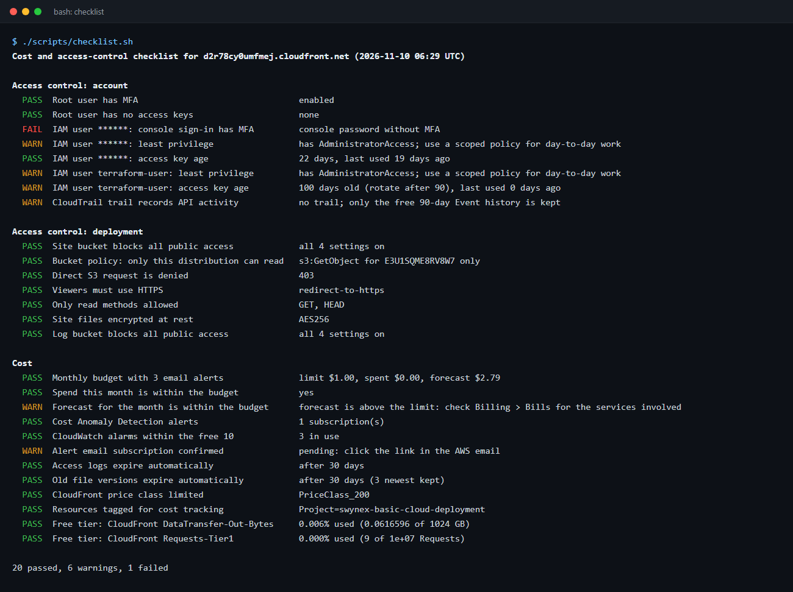
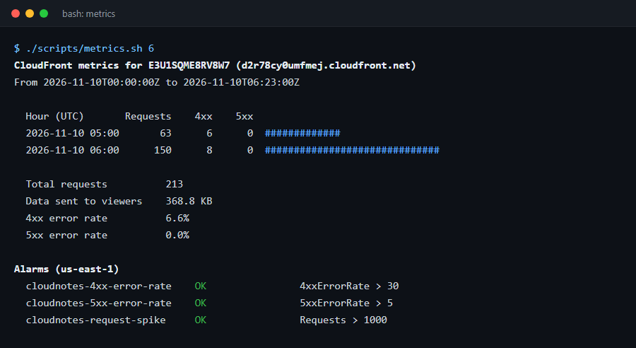
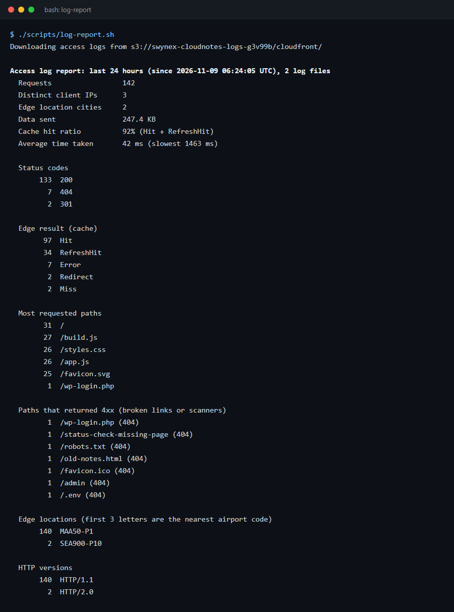
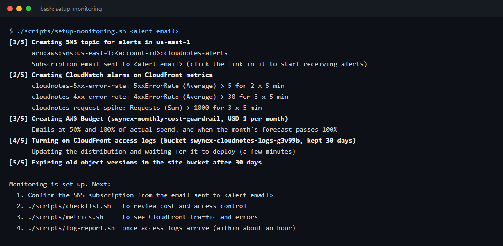

# CloudNotes Lite: Monitoring and Cost Awareness

**Status checks, logs, alerts, and cost and access-control checklists for the Task 2 deployment on Amazon S3 and CloudFront**

**Monitored site: https://d2r78cy0umfmej.cloudfront.net**

## Internship task context

| | |
|---|---|
| **Internship** | Cloud Computing Internship, SWYNEX Technologies |
| **Task** | Task 3: Monitoring and Cost Awareness |
| **Deliverable** | Logs or status checks, a simple alert idea, and a short cost and access-control checklist for the deployment |
| **Builds on** | [Task 2: Basic Cloud Deployment](https://github.com/YuvanDhurkesh/SWYNEX-Basic-Cloud-Deployment) (CloudNotes Lite on S3 + CloudFront) and [Task 1: architecture outline](https://github.com/YuvanDhurkesh/SWYNEX-Cloud-Architecture-Outline) |

## Summary

Task 2 deployed CloudNotes Lite, a static notes app, to a private S3 bucket behind CloudFront. This task adds monitoring to that live deployment and reviews its cost and access control. Everything below runs against the real deployment, and all of it stays within the AWS free tier.

| Part of the task | What was done | Details |
|---|---|---|
| Logs and status checks | An HTTP status check run locally and every 3 hours by GitHub Actions, CloudWatch metrics, and CloudFront access logs with a report script | [docs/monitoring.md](docs/monitoring.md) |
| Simple alert idea | Email when more than 5% of requests fail with 5xx for 10 minutes, plus alarms for 4xx rate and traffic spikes, and a USD 1 monthly budget | [docs/alerts.md](docs/alerts.md) |
| Cost checklist | 10 items, 9 met. Two fixes were applied: old file versions and logs now expire | [Cost checklist](#cost-checklist) |
| Access-control checklist | 12 items, 8 met. Four account-level gaps were found, each with a fix | [Access-control checklist](#access-control-checklist) |

The checklists are automated: [`scripts/checklist.sh`](scripts/checklist.sh) checks every item against the AWS account using only free, read-only API calls.

## What was added to the deployment



| New resource | Region | Purpose |
|---|---|---|
| SNS topic `cloudnotes-alerts` with an email subscription | us-east-1 | Delivers the alarm emails |
| 3 CloudWatch alarms (`cloudnotes-5xx-error-rate`, `cloudnotes-4xx-error-rate`, `cloudnotes-request-spike`) | us-east-1 | Watch the free CloudFront metrics |
| AWS Budget `swynex-monthly-cost-guardrail` (USD 1, alerts at 50%, 100% and forecast 100%) | Global | Catches any unexpected cost in the account |
| S3 bucket `swynex-cloudnotes-logs-g3v99b` | ap-south-1 | CloudFront access logs, kept for 30 days |
| CloudFront standard logging | Global | Writes one line per request to the log bucket |
| Lifecycle rule on the site bucket | ap-south-1 | Deletes old file versions after 30 days, keeping the 3 newest |
| GitHub Actions workflow `uptime-check.yml` | GitHub | External status check every 3 hours |

Everything is created by [`scripts/setup-monitoring.sh`](scripts/setup-monitoring.sh) and removed by [`scripts/teardown-monitoring.sh`](scripts/teardown-monitoring.sh). Each resource is tagged `Project=swynex-basic-cloud-deployment`.

## 1. Logs and status checks

Three views of the same site, from outside in. The full guide is in [docs/monitoring.md](docs/monitoring.md).

| Check | Tool | Result on 10 November 2026 |
|---|---|---|
| Is the site up for visitors? | `scripts/status-check.sh` (also scheduled in GitHub Actions) | 8 OK, 0 WARN, 0 FAIL; 315 ms; build `504ae5f` served from Chennai (`MAA50-P1`) |
| How much traffic, and how many errors? | CloudWatch metrics via `scripts/metrics.sh` | 213 requests, 369 KB, 4xx rate 6.6%, 5xx rate 0%; all 3 alarms OK |
| Who requested what, and did the cache work? | CloudFront access logs via `scripts/log-report.sh` | 92% cache hit ratio, average 42 ms at the edge; test requests for scanner paths such as `/wp-login.php` and `/.env` were listed as 404s, as was a real crawler's `/robots.txt` |
| Who changed the infrastructure? | CloudTrail Event history (console) | Free, last 90 days |

```
$ ./scripts/status-check.sh
Status check for https://d2r78cy0umfmej.cloudfront.net at 2026-11-10 06:21 UTC
  OK    Home page is up                        HTTP 200
  OK    Response time                          315 ms
  OK    Static assets load                     styles.css, app.js, build.js
  OK    HTTP redirects to HTTPS                301
  OK    HSTS header                            max-age=31536000
  OK    Missing page returns 404               404
  OK    Direct S3 access is blocked            403
  OK    TLS certificate                        valid for 120 more days
  INFO  Edge cache result                      RefreshHit from cloudfront (edge location MAA50-P1)
  INFO  Deployed build                         504ae5f

8 OK, 0 WARN, 0 FAIL
```

## 2. Alert idea

> **If more than 5% of requests fail with a server error (5xx) for 10 minutes, email the owner.**

A static site has no server whose CPU or memory could be watched. What visitors actually notice is errors, and the CloudFront `5xxErrorRate` metric measures exactly that. It is free and already collected. The alarm is live, together with two companion alarms and a budget:

| Alert | Fires when | Catches |
|---|---|---|
| `cloudnotes-5xx-error-rate` | 5xx rate > 5% for 2 × 5 minutes | Broken bucket policy or OAC, missing files, AWS outage |
| `cloudnotes-4xx-error-rate` | 4xx rate > 30% for 3 × 5 minutes | Broken links after a deploy, heavy bot scanning |
| `cloudnotes-request-spike` | More than 1,000 requests per 5 minutes for 15 minutes | Traffic that would use up the 10 million free requests a month |
| Budget | Spend > USD 0.50 or > USD 1, or forecast > USD 1 | Any unexpected cost in the account |
| GitHub Actions uptime check | `status-check.sh` fails | Site down, even if the AWS alert path is also broken |

The thresholds, the reason for each design choice, a step-by-step runbook for every alert, and the command to test one are in [docs/alerts.md](docs/alerts.md).

## Cost checklist

Result of `./scripts/checklist.sh` on 10 November 2026.

| # | Check | Status | Notes |
|---|---|---|---|
| 1 | A monthly budget with email alerts exists | ✅ | USD 1, alerts at 50%, 100% and forecast 100% |
| 2 | Spend this month is within the budget | ✅ | USD 0.00 so far |
| 3 | The month's forecast is within the budget | ⚠️ | AWS forecasts USD 2.79 for the **whole account**. This site's own usage is far inside the free tier (see 8), so the forecast comes from other resources in the account. The forecast alert will point to them, which is what an account-wide budget is for |
| 4 | Cost Anomaly Detection is on | ✅ | Daily email alerts were already set up |
| 5 | CloudWatch alarms fit in the free 10 | ✅ | 3 in use |
| 6 | Logs cannot grow forever | ✅ fixed | Access logs are deleted after 30 days |
| 7 | Old file versions cannot pile up | ✅ fixed | Versioning kept every old copy forever. A lifecycle rule now deletes them after 30 days and keeps the 3 newest for rollback |
| 8 | Usage is inside the CloudFront free tier | ✅ | 0.006% of 1 TB data transfer, and well under 0.01% of 10 million requests |
| 9 | CloudFront price class is limited | ✅ | `PriceClass_200`, which includes India and leaves out the most expensive regions |
| 10 | Resources are tagged for cost tracking | ✅ | `Project=swynex-basic-cloud-deployment` on every resource |

**What the monitoring itself costs**

| Item | Free allowance | Used | Monthly cost |
|---|---|---|---|
| CloudFront default metrics | Included | 5 metrics | USD 0 |
| CloudWatch alarms | 10 alarms | 3 | USD 0 |
| CloudWatch API (`metrics.sh`) | 1 million requests | 4 per run | USD 0 |
| SNS email | 1,000 emails | A few | USD 0 |
| AWS Budgets | Budgets without actions are free | 1 | USD 0 |
| CloudFront access logs | No delivery charge, only S3 storage | A few KB a day, deleted after 30 days | Less than USD 0.01 |
| GitHub Actions | Free for public repositories | 8 short runs a day | USD 0 |

Left out on purpose because they cost money: the Cost Explorer API (charged for each request, so `checklist.sh` reads budgets and Free Tier usage instead), CloudFront additional metrics (billed as custom metrics), Route 53 health checks, and a KMS key for the SNS topic.

## Access-control checklist

| # | Check | Status | Notes and fix |
|---|---|---|---|
| 1 | Site bucket blocks all public access | ✅ | All four Block Public Access settings are on |
| 2 | Only this distribution can read the bucket | ✅ | Bucket policy allows `s3:GetObject` to `cloudfront.amazonaws.com` only when `AWS:SourceArn` is this distribution |
| 3 | A direct request to S3 is denied | ✅ | Returns 403 (checked every 3 hours by the status check) |
| 4 | Viewers must use HTTPS | ✅ | `redirect-to-https`, with HSTS |
| 5 | Only read methods are allowed | ✅ | GET and HEAD |
| 6 | Files are encrypted at rest | ✅ | SSE-S3 on the site bucket and the log bucket |
| 7 | Root user has MFA and no access keys | ✅ | Both met |
| 8 | Every console user has MFA | ❌ | One IAM user with console access has no MFA (name not shown here). **Fix:** IAM → Users → user → Security credentials → Assign MFA device |
| 9 | Deployments use least privilege | ⚠️ | Both IAM users have `AdministratorAccess`, including the one the scripts run as. **Fix:** deploy with a user or role that has only [`policies/cloudnotes-deployer.json`](policies/cloudnotes-deployer.json) (upload, delete and invalidate, for this bucket and distribution only), and read monitoring data with [`policies/cloudnotes-monitoring-readonly.json`](policies/cloudnotes-monitoring-readonly.json) |
| 10 | Access keys are rotated within 90 days | ⚠️ | The CLI user's key is 100 days old. **Fix:** create a second key, switch `aws configure` to it, then deactivate and delete the old one |
| 11 | API activity is kept beyond 90 days | ⚠️ | No CloudTrail trail exists, so only the free 90-day Event history is kept. **Fix:** create one multi-region trail for management events. The first copy of management events is free, and the only cost is S3 storage |
| 12 | Monitoring data is private | ✅ | Log bucket blocks all public access, logs expire, and the report never prints IP addresses. The alert email address is kept out of the repository |

Items 8 to 11 are account-level settings that affect other users, so they are recorded here as actions rather than changed by the scripts.

## Repository structure

```
SWYNEX-Monitoring-and-Cost-Awareness/
├── monitoring.conf               Names and IDs of the Task 2 resources, thresholds, retention
├── scripts/
│   ├── status-check.sh           External health check (no AWS credentials needed)
│   ├── metrics.sh                CloudFront traffic and error rates from CloudWatch, alarm states
│   ├── log-report.sh             Summary of CloudFront access logs
│   ├── checklist.sh              Automated cost and access-control checklist (read-only)
│   ├── setup-monitoring.sh       Creates the alarms, SNS topic, budget, log bucket and lifecycle rules
│   ├── teardown-monitoring.sh    Removes everything setup-monitoring.sh created
│   └── lib.sh                    Shared helpers
├── policies/
│   ├── cloudnotes-deployer.json             Least-privilege policy for deploy.sh
│   └── cloudnotes-monitoring-readonly.json  Read-only policy for metrics.sh and log-report.sh
├── .github/workflows/uptime-check.yml       Status check every 3 hours
├── docs/
│   ├── monitoring.md             Logs and status checks in detail
│   ├── alerts.md                 Alert design and runbook
│   └── screenshots/
└── README.md
```

## How to use it

Prerequisites: the Task 2 deployment, AWS CLI v2 signed in to the same account, Bash (Git Bash works on Windows), `curl`, `openssl` and Python 3.

```bash
git clone https://github.com/YuvanDhurkesh/SWYNEX-Monitoring-and-Cost-Awareness.git
cd SWYNEX-Monitoring-and-Cost-Awareness

./scripts/status-check.sh                      # works without AWS credentials
./scripts/setup-monitoring.sh you@example.com  # once; then confirm the SNS email
./scripts/metrics.sh 24                        # traffic and errors, last 24 hours
./scripts/log-report.sh 24                     # access log summary, last 24 hours
./scripts/checklist.sh                         # cost and access-control checklist
./scripts/teardown-monitoring.sh               # remove the monitoring resources
```

To point the scripts at a different deployment, edit `monitoring.conf`.

## Screenshots

### Status check


### Cost and access-control checklist


### CloudWatch metrics and alarm states


### Access log report


### Setting up the monitoring


The IAM user name, the AWS account ID and the alert email address are hidden in the screenshots.

## Problems found and how they were fixed

| Problem | Cause | Fix |
|---|---|---|
| The checklist reported "root access keys exist" when there were none | On Windows the AWS CLI ends lines with `\r\n`, so `0\r` did not equal `0` | `lib.sh` wraps `aws` to strip carriage returns, keeping the CLI's exit status through `pipefail` |
| Hourly metrics were labelled with IST hours instead of UTC | The AWS CLI prints CloudWatch timestamps in the local time zone | `metrics.sh` converts every timestamp to UTC with `date -u` |
| Old copies of site files were never deleted | Task 2 turned on versioning for rollback but set no expiry | Lifecycle rule: delete old versions after 30 days, keep the 3 newest |
| Alarms on a low-traffic site would sit in `INSUFFICIENT_DATA` | CloudFront sends no data points in minutes with no requests | `--treat-missing-data notBreaching` |
| CloudFront alarms cannot be created in ap-south-1 | CloudFront metrics exist only in us-east-1 | Alarms and their SNS topic are created in us-east-1 |

## Key learnings

- For a static site, error rates matter more than server metrics, and CloudFront already provides them for free. Choosing what to alert on is most of the work.
- Every alarm needs a short runbook. An email that says "5xx > 5%" is only useful if it says what to check first, so each alarm description links to its runbook.
- Logging has its own cost and privacy risks. Logs with no expiry grow forever, and access logs hold IP addresses, so retention is part of the design.
- Cost awareness includes the tools themselves: the Cost Explorer API charges for each call, while Budgets and the Free Tier API give enough for a small project at no cost.
- Automating the checklist found real problems that a quick look in the console missed: a console user without MFA, an old access key, and unlimited version history.
- The `AWS:SourceArn` condition in the bucket policy is what the "direct S3 access is blocked" check depends on. Running that check every 3 hours means a change to it would be noticed.
