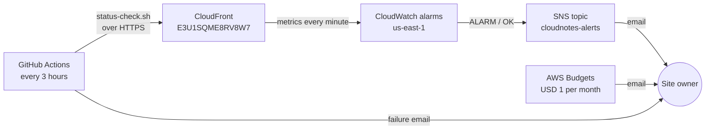

# Alerts and runbook

## The alert idea

**If more than 5% of requests to the site fail with a server error (5xx) for 10 minutes, email the owner.**

For a static site on S3 and CloudFront there is no server to watch for CPU or memory. The failures that matter are:

- CloudFront cannot read from S3, for example because the bucket policy or OAC was changed.
- Files are missing after a bad deploy.
- An AWS service is having problems.

The first and last show up as 5xx responses, so the CloudFront `5xxErrorRate` metric is the clearest single sign that visitors are getting errors. Two companion alarms and a budget cover the other two risks: broken links and unexpected cost.

## Alerts in place

| Alert | Condition | Sent to | Why this threshold |
|---|---|---|---|
| `cloudnotes-5xx-error-rate` | `5xxErrorRate` average > 5% in 2 consecutive 5-minute periods | SNS topic `cloudnotes-alerts` → email | Two periods filter out a single failed request, while a real outage still alerts within about 10 minutes |
| `cloudnotes-4xx-error-rate` | `4xxErrorRate` average > 30% for 15 minutes | SNS → email | Normal traffic has a few 404s from crawlers and bots (6% in the sample, which included test requests). A sustained 30% means broken links after a deploy, or a heavy scan |
| `cloudnotes-request-spike` | `Requests` sum > 1,000 per 5 minutes for 15 minutes | SNS → email | The CloudFront free tier is 10 million requests a month, about 1,160 per 5 minutes on average. Sustained traffic above 1,000 per 5 minutes would use up the free tier, whether from real visitors or a bot |
| Budget `swynex-monthly-cost-guardrail` | Actual spend > 50% and > 100% of USD 1, or forecast > 100% | Email (AWS Budgets) | Catches cost from any service in the account, not only this site |
| Cost Anomaly Detection (already on) | Unusual daily spend for a service | Email, daily | Free, and catches a sudden change the fixed budget would only see later |
| GitHub Actions uptime check | `status-check.sh` fails | GitHub email to the repository owner | Independent of AWS, so it still works if the AWS alerting path fails |

Each CloudWatch alarm also sends an **OK** notification, so the owner knows when the problem has cleared without checking the console.

## How an alert travels



## Design choices

- **The alarms are in us-east-1.** CloudFront publishes its metrics only there, and an alarm must be in the same region as its metric. The SNS topic is there too, because an alarm can only notify a topic in its own region.
- **Missing data is treated as "not breaching".** CloudFront sends no data points in a minute with no requests. A low-traffic site would otherwise flip to `INSUFFICIENT_DATA` all the time.
- **The SNS topic is not encrypted.** CloudWatch cannot publish to a topic encrypted with the AWS managed `aws/sns` key, and a customer managed KMS key has a monthly charge. The alert text contains no secrets: it gives the alarm name, the metric and the threshold.
- **Email is the only channel.** It is free for up to 1,000 emails a month. For a team, the same SNS topic could also send to Slack or Microsoft Teams through AWS Chatbot.

## Runbook

The description of every alarm links to this section, so the alert email points straight at what to do.

### `cloudnotes-5xx-error-rate`: visitors are getting server errors

1. Run `./scripts/status-check.sh`. Note which checks fail and the edge location shown.
2. Check the [AWS Health Dashboard](https://health.aws.amazon.com/health/status) for CloudFront or S3 problems.
3. Open CloudTrail → **Event history** and filter by the bucket name and distribution ID. Look for recent `PutBucketPolicy`, `DeleteBucketPolicy`, `UpdateDistribution` or `DeleteObject` events.
4. If the bucket policy was changed, put back the policy from Task 2 (`AWS:SourceArn` must match the distribution). If files are missing, run `./scripts/deploy.sh` in the Task 2 repository.
5. The alarm clears itself, and you get an **OK** email once two 5-minute periods are back under 5%.

### `cloudnotes-4xx-error-rate`: many requests are for missing pages

1. Run `./scripts/log-report.sh 2` and read **Paths that returned 4xx**.
2. If the paths are the site's own files (for example `/app.js`), a deploy removed or renamed them: redeploy from the last good commit.
3. If they are paths like `/wp-login.php` or `/.env`, a bot is scanning. They get the 404 page and nothing is exposed. If it goes on, add AWS WAF rate limiting, which has a monthly charge.

### `cloudnotes-request-spike`: unusually high traffic

1. Run `./scripts/log-report.sh 1` and look at the top paths and edge locations to see whether it is real visitors or one bot.
2. Run `./scripts/checklist.sh` to see free tier usage for the month.
3. If it is abuse, AWS WAF with a rate-based rule blocks it at the edge. If it is real traffic, it is good news: check that the budget still fits.

### Budget alert: spend has passed a threshold

1. Open **Billing and Cost Management** → **Bills** and find the service that is charging.
2. If it is not this site, find and stop the resource. The budget covers the whole account on purpose.
3. If it is this site, see the cost checklist in the [README](../README.md#cost-checklist).

## Testing the alert

After confirming the SNS subscription email, set an alarm into the `ALARM` state by hand. CloudWatch sends the notification email, then sets the alarm back to `OK` at its next evaluation, which sends a second email:

```bash
aws cloudwatch set-alarm-state --region us-east-1 \
  --alarm-name cloudnotes-5xx-error-rate \
  --state-value ALARM \
  --state-reason "Manual test of the alert path"
```

To test the GitHub path, run the **Uptime check** workflow from the Actions tab.
